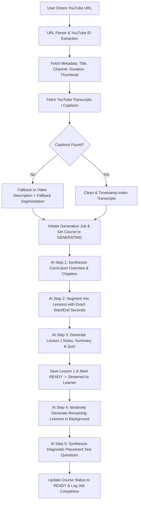

# AI Processing Workflow & Synthesis Pipeline

This document describes the step-by-step AI generation pipeline, prompt engineering strategy, streaming availability, error handling, and provider abstraction.

---

### End-to-End Pipeline Flow (Mermaid)



---

### Modular AI Provider Abstraction
The AI engine implements an adapter interface:

```typescript
export interface AIProvider {
  name: string;
  generateCompletion(prompt: string, systemPrompt?: string): Promise<string>;
  generateJSON<T>(prompt: string, schemaDescription: string): Promise<T>;
}
```

Configured via environment variables:
- `AI_PROVIDER`: `"nemotron"` | `"openai"` | `"local"`
- `NVIDIA_API_KEY`: API key for NVIDIA API Catalog (Nemotron models)
- `NVIDIA_BASE_URL`: `https://integrate.api.nvidia.com/v1`
- `NVIDIA_MODEL`: `nvidia/nemotron-4-340b-instruct` or `meta/llama-3.1-70b-instruct`
- `OPENAI_API_KEY`: API key for OpenAI
- `OPENAI_MODEL`: `gpt-4o-mini` or `gpt-4o`

If no external API key is set in `.env`, the system uses an intelligent deterministic synthesizer (`LocalDeterministicProvider`) that parses transcripts and metadata to produce genuine, high-quality, timestamp-mapped lessons, notes, placement tests, and quizzes. This ensures that the platform is 100% testable immediately while remaining fully plugged into real LLMs when keys are provided.

---

### Lesson Splitting & Timestamp Mapping
For a 1-hour video (3600 seconds):
- AI parses semantic topic changes in the transcript.
- Generates 4-6 lessons (e.g., Lesson 1: 00:00 - 12:40, Lesson 2: 12:40 - 24:15, Lesson 3: 24:15 - 38:00, etc.).
- Each quiz question identifies a precise `replayTimestampSeconds` (e.g. 845s = 14:05) where that topic was covered.
- If a user misses that question, the system provides a direct link and triggers a jump to 14:05 in the player.

