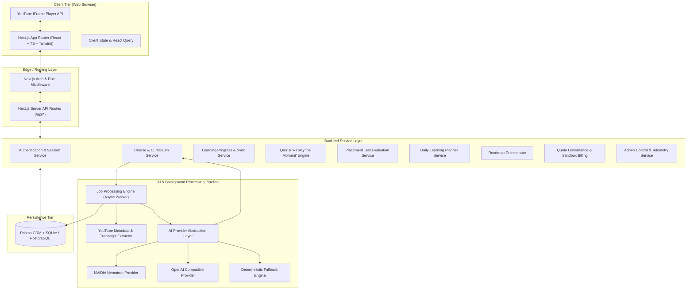

# System Architecture Specification

This document details the macro and micro architecture of the CourseIt-Style platform, including component boundaries, data flow, queue architecture, and subsystem interactions.

---

### High-Level Architectural Diagram (Mermaid)

---

### Component Breakdown

1. **Frontend Presentation Layer (Next.js 15 App Router):**
   - Modern React with Server Components (RSC) and Client Components where interactive state is required.
   - Styled with Tailwind CSS using a professional sky-blue and white design system.
   - Embeds the official YouTube IFrame Player API for native video playback, time-tracking, and frame-accurate seeking.

2. **API & Business Logic Layer:**
   - Server-side RESTful API routes under `/api/`.
   - Comprehensive request validation, role enforcement, and error normalization.
   - Authentication via secure, HTTP-only JWT cookies with bcrypt password encryption.

3. **AI Pipeline & Course Generator:**
   - Modular AI abstraction layer (`aiProvider.ts`) with adapter pattern supporting NVIDIA Nemotron, OpenAI, and a reliable fallback synthesizer.
   - Multi-phase curriculum construction:
     1. Metadata retrieval (title, author, thumbnail, duration).
     2. Transcript extraction (captions API or provided text).
     3. Chapter/lesson semantic topic segmentation.
     4. Lesson enrichment (summaries, key concepts, definitions).
     5. Quiz and timestamp generation ("Replay the Moment" integration).
     6. Placement test generation.
   - **Streaming First Lesson (TTFL):** Lesson 1 is synthesized and marked `READY` in the database immediately, allowing the learner to start watching without waiting for a 20-lesson playlist to finish building.

4. **Persistence Layer (Prisma ORM):**
   - SQLite for zero-config local reliability, fully swappable to PostgreSQL via environment variables.
   - Clean relational model with cascade constraints, foreign keys, and indexes on frequent lookup fields (`slug`, `userId`, `courseId`).

