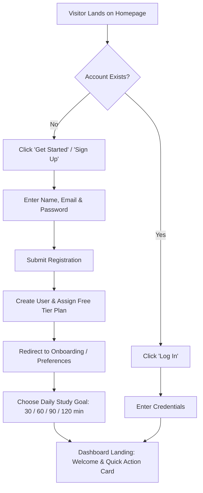
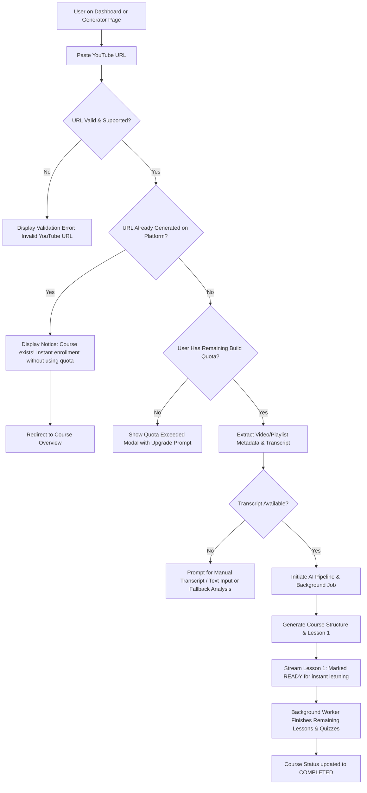
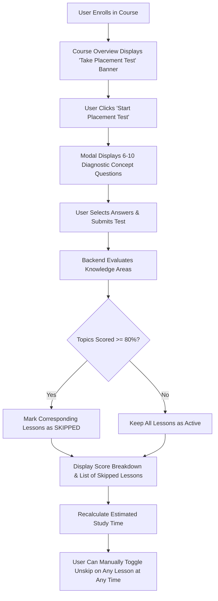
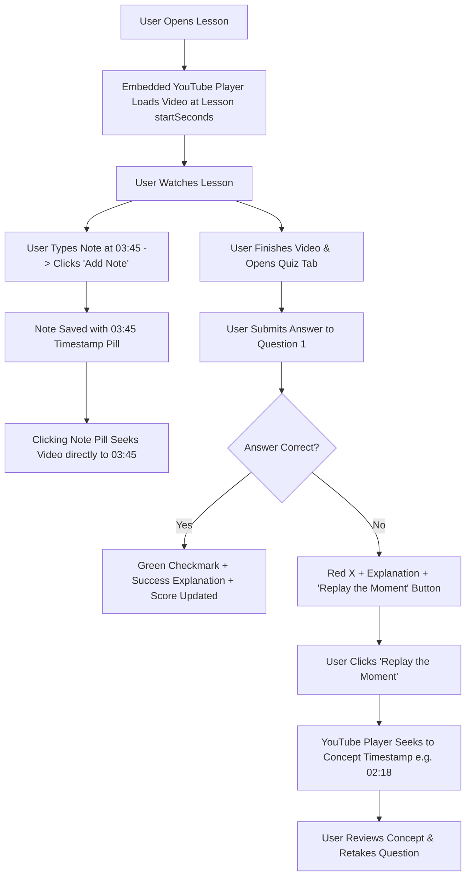
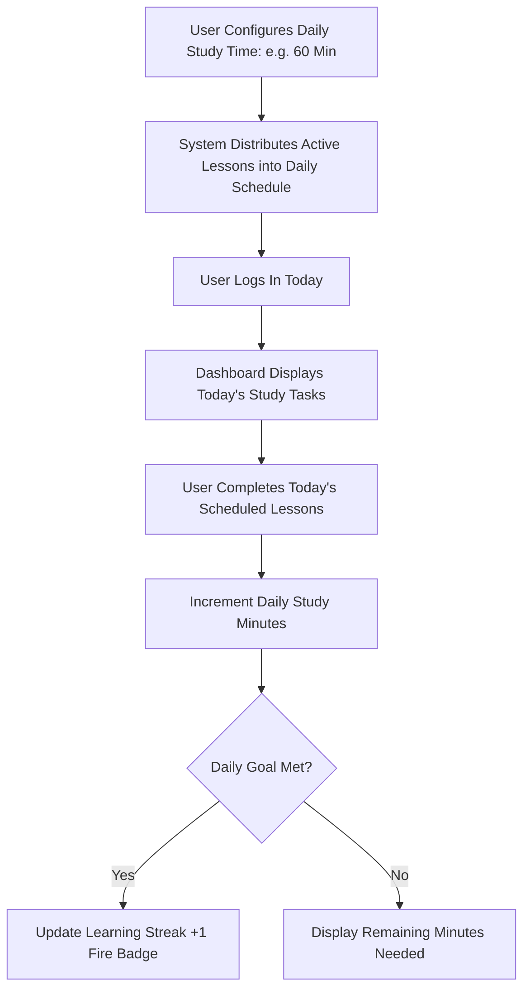
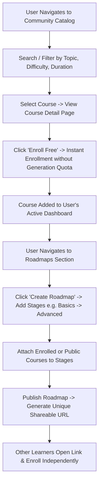
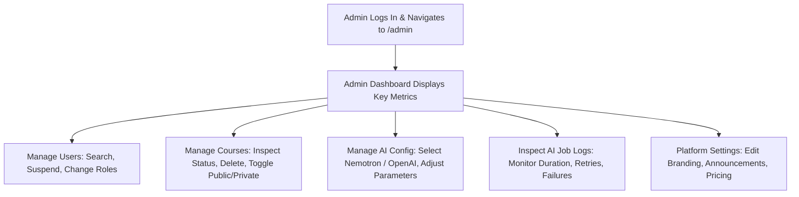

# User Journey Maps

This document outlines the detailed end-to-end user journeys across the key workflows of the platform.

---

### Journey 1: New Learner Registration & Onboarding


---

### Journey 2: YouTube Course Generation (Single Video / Playlist)


---

### Journey 3: Diagnostic Placement Test & Adaptive Curriculum


---

### Journey 4: Distraction-Free Lesson Player & "Replay the Moment"


---

### Journey 5: Daily Study Planner & Streaks


---

### Journey 6: Community Course Discovery & Roadmaps


---

### Journey 7: Subscription Upgrades & Billing Governance
```mermaid
flowchart TD
    A[Free User Approaches Limits or Clicks 'Upgrade'] --> B[Billing Page Displays Free, Pro ($19), Max ($49)]
    B --> C[User Selects Plan & Billing Frequency: Monthly / Yearly]
    C --> D[Sandbox Checkout Interface Launches]
    D --> E[User Confirms Upgrade Simulation]
    E --> F[Update User Subscription Tier & Reset Monthly Quota]
    F --> G[New Limits Reflected on Dashboard Instantly]
```

---

### Journey 8: Platform Administration


